<picture>
  <source media="(prefers-color-scheme: dark)" srcset="assets/header-dark.svg">
  
</picture>

### こんにちは! I'm Overwind

I write code for pretty much anything that compiles: games and game automation, Android stuff, web apps, backends and, apparently, Brazilian payroll law. Specialization is for people with fewer browser tabs open.

If something annoys me twice, I automate it. If it annoys other people too, it becomes open source. Tests are mandatory; dependencies are on probation.

Powered by tea, lo-fi and "just one more episode".

 

### Stuff I've shipped

- **[cnpj-alfa-scan](https://github.com/AstralunaProject/cnpj-alfa-scan)** finds the code that will break with Brazil's alphanumeric CNPJ: `BIGINT` columns, `parseInt`, `\d{14}`, digit-only masks. CLI, GitHub Action and Semgrep rules. [Try it in the browser](https://astralunaproject.github.io/cnpj-alfa-scan/).
- **[esocial-ts](https://github.com/AstralunaProject/esocial-ts)** builds, validates, signs and sends eSocial events from Node.js, with your A1 certificate staying on your machine.
- **[open-servicedesk](https://github.com/AstralunaProject/open-servicedesk)** is an IT helpdesk for small companies: tickets, SLAs, email, knowledge base and asset inventory, on your own server.
- **[calculadora-rescisao-clt](https://github.com/AstralunaProject/calculadora-rescisao-clt)** calculates CLT severance pay entirely in the browser, offline. [Open it](https://astralunaproject.github.io/calculadora-rescisao-clt/).
- **[open-contrib](https://github.com/AstralunaProject/open-contrib)** is a GitHub Action that turns an issue into an onboarding roadmap for whoever picks it up.

  <picture>
    <source media="(prefers-color-scheme: dark)" srcset="https://raw.githubusercontent.com/AstralunaProject/AstralunaProject/output/estatisticas-dark.svg">
    
  </picture>
  <picture>
    <source media="(prefers-color-scheme: dark)" srcset="https://raw.githubusercontent.com/AstralunaProject/AstralunaProject/output/contribuicoes-dark.svg">
    
  </picture>

<picture>
  <source media="(prefers-color-scheme: dark)" srcset="https://raw.githubusercontent.com/AstralunaProject/AstralunaProject/output/cobrinha-dark.svg">
  
</picture>

<table align="center">
  <tr>
    <td align="center"> hot fix</td>
    <td align="center"> after the deploy</td>
  </tr>
</table>
